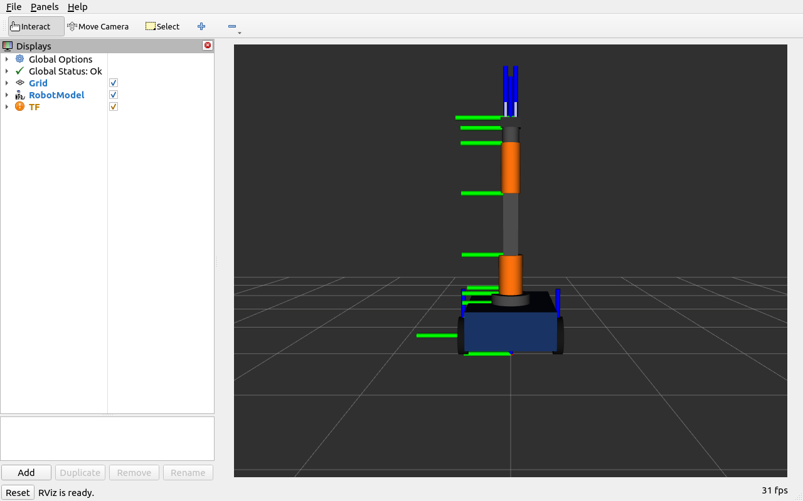
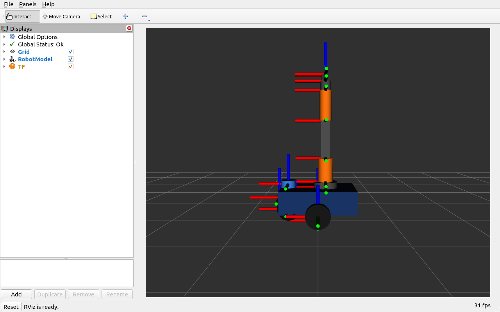

# mobile manipulator ros2

mobile manipulator assembling a differential drive base, sensor mast, 4-dof arm, and a 2-finger gripper into a single robot.

modular files:
- `urdf/mobile_base.xacro`: diff-drive base with 2 wheels, front caster, 2d lidar, and depth camera
- `urdf/arm.xacro`: 4-dof articulated arm
- `urdf/gripper.xacro`: parallel-jaw gripper with mimic joint
- `urdf/robot.xacro`: top level file combining the subsystems
- `config/controllers.yaml`: `ros2_control` configuration with diff_drive_controller and joint_trajectory_controller

launching in rviz:
```bash
ros2 launch launch/display.launch.py
```

screenshots:


